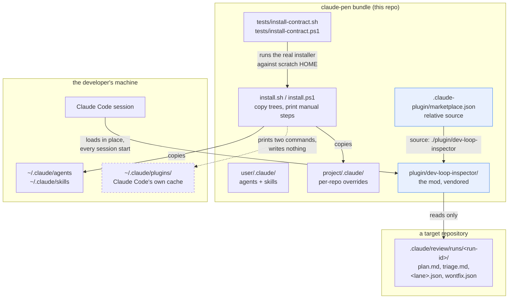
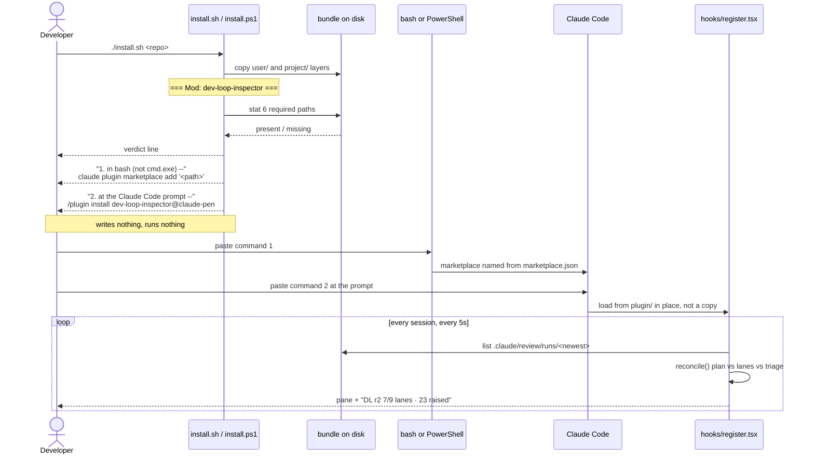

# dev-loop-inspector becomes part of the bundle

`dev-loop-inspector` is a Claude Code plugin that reads a dev-loop run's own
output directory and reports two failures nothing else in the loop can see: a
finding that was raised and then reached no triage file, and a lane the plan
classified `applicable` that never drained. It existed only in one machine's
mods folder. This change makes it a member of the distribution — vendored
source, a marketplace manifest, verification and instructions in both
installers, coverage in both contract suites, and documentation in both docs.

- **Branch**: `feat/dev-loop-inspector` → `main`
- **Diff base**: `f70cca7`
- **Run**: `.claude/review/runs/20261014-1052-feat-dev-loop-inspector`, full
  `dev-loop`, three rounds, 28 findings raised, 19 accepted

**Out of scope, and visible in this PR anyway**:
`docs/specs/2026-10-14-hospital-model-dev-loop-design.md` was committed onto
this branch by a different session while this run was in flight (commits
`45e84d8` and `9944dd6`). It is unrelated design work for GitHub issue #3, was
reviewed by nobody here, and the branch was left as-is by choice. Skip it.

Also out of scope by decision: four pre-existing defects inside the vendored
mod, recorded in `wontfix.json`; a repo-wide `.gitattributes` line-ending
policy; and any change to the five loop skills that write the files the mod
reads.

## Entrypoints

This is a distribution package, not an application, so there is no route or
command to start from — and there are **two** entrypoints, which is why the
walkthrough makes two passes.

| Entrypoint | Trigger | First changed file it reaches |
| --- | --- | --- |
| `./install.sh <repo>` / `.\install.ps1 -Repo <repo>` | a person installs the bundle | `install.sh:127` |
| Claude Code session start, once the mod is enabled | `hooks/hooks.json` → `register` | `plugin/dev-loop-inspector/hooks/register.tsx:157` |

The installer is the spine below, because that is what this change mostly
consists of and what the contract suites exercise. The mod's own flow gets a
shorter pass at step 5, since `scan.ts` is where the one behavioural fix landed.

## Where this sits



The dashed arrow is the point of the design. `~/.claude/plugins/` is Claude
Code's own cache and marketplace registry, not an install target — so the
installer never writes there. It verifies and advises; the person runs two
commands.

## The installer flow



## What changed

| File | What | Read it? |
| --- | --- | --- |
| `.claude-plugin/marketplace.json` | New. Makes the repo a marketplace; one entry, relative `source`. | **Yes** — 15 lines, and the whole install route hangs off it |
| `plugin/dev-loop-inspector/hooks/scan.ts` | Vendored, then **modified**: `laneKey` added. | **Yes** — the only behavioural change in the mod |
| `plugin/dev-loop-inspector/hooks/scan.test.ts` | Vendored, then **modified**: 2 tests added. | Yes |
| `plugin/dev-loop-inspector/hooks/register.tsx` | Vendored, byte-identical to origin. | Skim — authored elsewhere, not changed here |
| `plugin/dev-loop-inspector/hooks/hooks.json`, `tsconfig.json`, `types/index.d.ts`, `.claude-plugin/plugin.json`, `.claude-plugin/types/.gitignore` | Vendored, byte-identical. | Ignore these — `cmp`-verified against origin |
| `install.sh` | Mod section; `SKILLS_LABEL`; threshold 12→13. | **Yes** |
| `install.ps1` | The same four changes. | **Yes** — read beside `install.sh`, not after it |
| `tests/install-contract.sh` | 36 → 44 assertions. | **Yes** |
| `tests/install-contract.ps1` | 36 → 46 assertions. | **Yes** — and the count differs on purpose |
| `README.md`, `INSTALL.md` | Mod documented; a false claim corrected. | Yes |
| `.gitignore` | One rule, for an engine-generated directory. | Yes — 6 lines, and not obvious |
| `.claude/review/conventions.md` | New. Three standing triage decisions. | Yes — it changes what future reviews may raise |
| `docs/specs/2026-10-14-hospital-model-dev-loop-design.md` | **Ignore this** — another session's work, see above. | No |

## Following the flow

### 1. `install.sh:127` — the mod section, and why it sits where it does

Everything above this line in both installers does one kind of thing: copy a
tree, back up what it would clobber, print a manual step. The new section does
something different — it verifies a tree it does **not** install, and prints
commands it does **not** run.

Its position was forced, not chosen. Both scripts `exit 0` before
`=== Verify ===` when run with `--dry-run` / `-WhatIfOnly` (`install.sh:170`, `install.ps1:172`).
The section has to report under a dry run, because a dry run is exactly when
someone is checking what the installer will do. So the only slot that is both
before `=== Verify ===` and before the early exit is this one. Putting it first
would read as though the mod were the bundle's headline; duplicating it either
side of the exit would mean two code paths to hold in lockstep for no gain.

`install.sh:140` sets `MOD_COMPLETE=1` and the loop beneath it stats six paths.
Six, not four, and the membership rule is stated in the comment: **every path a
manifest declares, plus every module actually loaded.** That rule was earned.
The first version listed four, omitting `hooks/scan.ts` — which
`register.tsx` imports — so a partial unzip that lost it reported "present".
Adding `types/index.d.ts` was the less obvious half: `import type` is erased at
runtime, so it is genuinely not needed to *load* the mod, but `plugin.json`
declares it and `claude plugin validate` fails with `Path not found` without
it. Deleting it on a scratch copy left `claude plugin test` at 9/9 — the test
suite proves nothing about that file, only `validate` does.

The enablement commands print unconditionally, even when the tree is
incomplete. That is deliberate: it keeps the section's output shape identical on
every run, which is what makes the idempotence assertion possible.

**This section prints a path into a command the user is told to paste. That
line is followed next.**

### 2. `install.sh:160` — the densest line in the diff

```sh
QUOTE="'"
HERE_QUOTED="$QUOTE${HERE//$QUOTE/$QUOTE\\$QUOTE$QUOTE}$QUOTE"
```

Single quotes, with an embedded apostrophe escaped as `'\''`. `install.ps1:165`
does the same job with `$here.Replace("'", "''")`, because PowerShell has a
real escape and bash does not — a literal single quote cannot appear inside a
single-quoted bash string, which is the entire reason for the `QUOTE` variable.

This started as double quotes, and the Security lane proved by execution that a
bundle directory named with `$(…)` and a backtick executed **both** payloads
when the printed line was pasted. So the quoting had to change. The remedy
chosen was to always print a form that cannot re-enter the parser, rather than
to detect dangerous paths and refuse — a metacharacter allowlist is the same
category of bug being fixed, and a refusal branch cannot be driven red by a
test.

Then the fix turned out to have broken a third shell. **`cmd.exe` does not treat
`'` as a quote at all**, so a bundle named `bundle & mkdir pwned` splits the
pasted line at the `&` and runs the tail. That was proven the same way: a
scratch bundle with that name, the printed line fed to `cmd.exe` both as a batch
line and through stdin, a shadowed `claude` recorder on PATH, and a `pwned'`
directory left behind — note the trailing quote, which matters in the tests
below.

There is no quoting that is correct in bash, PowerShell and `cmd.exe` at once.
So the printed label names the one shell its own line is correct for —
`install.sh:163` says `1. in bash (not cmd.exe) --`, `install.ps1:167` says
`1. in PowerShell (not cmd.exe) --`. Round 2 had made both labels identical for
lockstep, which was worse than it looks: `install.sh` prints a POSIX `/c/...`
path PowerShell cannot resolve, and `install.ps1` prints `''` escaping that bash
collapses, silently dropping the apostrophe. Each label named a shell in which
its own printed line does not work. Accuracy of a pasted instruction beat
textual symmetry between two scripts.

Reverting to double quotes was considered at each step and rejected every time —
re-verified byte-exact — because it reopens command execution in bash and
PowerShell, which are the two shells people actually paste into.

### 3. `.claude-plugin/marketplace.json` — why this file is at the root

A marketplace is a property of a *repository*, not of a subdirectory, so the
manifest cannot live inside `plugin/`. Its one entry's `source` is the relative
path `./plugin/dev-loop-inspector`, and that relativeness is load-bearing: a
marketplace whose source is a relative path is read **from that folder**, not
from the copy `claude plugin install` makes. An unzipped bundle therefore runs
the mod in place, with no second copy to drift.

The marketplace's `name` is the fixed string `claude-pen`, deliberately not
derived from the folder. Verified by installing from a bundle copied to
`…\unzipped here\claude pen 1.0` — two spaces, renamed folder — which still
produced a marketplace named `claude-pen`. Had the name followed the folder,
`dev-loop-inspector@claude-pen` would break for anyone who renamed their unzip.

The entry `name` and `plugin.json`'s `name` must agree or `/plugin install`
answers `Plugin "…" not found in marketplace`, which is why three separate
assertions pin that chain rather than one.

**The brief for this change specified the wrong command here.** It said
`/plugin install dev-loop-inspector --marketplace claude-pen`. `--marketplace`
takes a *source* — a path, a URL, `owner/repo` — and adds it; naming an
already-added marketplace is the `@` form. The CLI rejects the brief's version
outright. The shipped command is `dev-loop-inspector@claude-pen`, and both
suites assert the absence of the invalid pairing so it cannot return.

### 4. `plugin/dev-loop-inspector/hooks/scan.ts:18` — `laneKey`, and the invariant that makes it safe

```ts
const laneKey = (lane: string): string =>
  lane.toLowerCase().replace(/[^a-z0-9]/g, '').replace(/^lite/, '')
```

`reconcile` matches a plan table's lane name against a findings file's stem.
Originally it compared them with string equality, so a lane written `Dead code`
never matched `deadcode.json` — producing, on this very run, a false alarm
*and* a false note. The defect pre-dated the vendoring, which by the loop's own
rules means record it and move on. It was fixed instead, by explicit decision,
on the grounds that a pre-existing defect in code a change is **newly
distributing** reaches every user of that distribution.

The `^lite` strip is the second half, and it is the part a reviewer should
check carefully. The lite reviewer agents write `lite-correctness.json`,
`lite-structure.json`, `lite-tests.json`, `lite-security.json`, while the lite
plan tables name those lanes `Correctness`, `Structure`, `Tests`, `Security` —
four mismatches of four in a lite round. Renaming the table cells instead does
not work: `parsePlanLanes` filters on `/^[a-z][a-z ]*$/` (`scan.ts:32`), which
rejects a hyphen, so the row would never enter `planned` at all and the headline
check would silently stop running for that lane — trading a false positive for a
false negative.

**The strip is sound only because of per-round uniqueness, not global
uniqueness.** The global key space genuinely collides: `lite-tests` → `tests`
and `lite-security` → `security`. What makes it safe is that no loop pairs a
full lane with its lite twin, and `register.tsx:83-96` builds one `RoundInput` per
`round-N` directory, so `reconcile` only ever compares keys within a single
round. That invariant is written above the function. A reviewer who checks only
the global claim will think this is a bug — and the review that produced this
fix asserted global distinctness, which was false as written and was corrected
during the fix.

Both call sites route through `laneKey` (`scan.ts:134` and `scan.ts:158`).
Normalising one and not the other converts the false alarm into a false note
rather than removing it, which is why the regression tests pin each
independently.

### 5. `register.tsx:157` — the mod's own entrypoint, briefly

Nothing here changed; it is vendored byte-identical. One pass for orientation:
`session.start` registers the `/dev-loop-inspect` command and a 5-second
`$.clock.every`; `command.run` answers with the same report as text;
`ui.render` draws the pane. `scan.ts` is pure parsing and reconciliation,
`register.tsx` is all engine interaction and drawing. The split means the eight
reconciliation tests need no engine at all, which is why `claude plugin test`
runs in 1.3 seconds.

## The decisions

### `plugin/` is a layer that installs nowhere

Every other top-level layer is defined by where its contents get copied:
`user/.claude/` → `~/.claude/`, `project/.claude/` → `<repo>/.claude/`. This one
is enabled in place. Rejected alternatives: nesting it under `user/.claude/` so
the existing bulk copy picks it up (the skills copy would put it somewhere
nothing loads from); auto-loading it from `~/.claude/skills/dev-loop-inspector`,
which works by side effect of the skills watcher rather than by the plugin
contract; and copying into `~/.claude/plugins/`, which is a cache.

The singular name matches `project/`, which is also one thing. A second mod
would want `plugins/` — that rename touches `marketplace.json`'s source, one
`.gitignore` rule and two doc table rows, so it stays cheap to reverse.

### The installers never write `settings.json`

Enabling a plugin means an `enabledPlugins` entry. The installer could merge one
and back the file up first — and does not, by explicit choice. This repo's
standing contract is copy-then-print: `CLAUDE.md` and `standards.md` are never
clobbered, you get a `.new` file and a message. An installer that silently
edited `~/.claude/settings.json` would be the first exception. Both suites
assert the absence of any such write, and the plugins-registry assertion
baselines its digest while the scratch `HOME` is still pristine — the obvious
before-and-after version **passed against an installer deliberately broken to
write there**, because earlier installs in the same suite had already put
identical bytes in that directory.

### `.claude-plugin/types/` is ignored, and the file that ignores it is tracked

Claude Code writes about 1 MB of version-specific `.d.ts` files into the
vendored mod's `.claude-plugin/types/` the first time it loads the mod. The
mod's own `.gitignore` in that folder contains `*` — which ignores itself, so it
cannot be committed normally and a fresh clone would have no ignore there at
all. The obvious rescue, a root rule plus a `!….gitignore` negation, was probed
in a throwaway repo and **does not work**: a deeper `.gitignore` takes
precedence, so the nested `*` still wins. So the root `.gitignore` carries the
real rule and the nested file is tracked with `git add -f`, kept so the vendored
tree remains a faithful self-contained copy if anyone lifts it elsewhere.

Consequence worth knowing: `plugin/dev-loop-inspector/tsconfig.json` extends
`./.claude-plugin/types/tsconfig.json`, which the engine generates. `tsc -p`
cannot resolve its own base config in a fresh clone until Claude Code has loaded
the mod once. The Artifacts lane judged that acceptable rather than a missing
artifact.

### The vendored copy is deliberately newer than its origin

Six of the eight vendored files are byte-identical to
`~/.claude/dev-mods/921481a3-…/dev-loop-inspector/`, `cmp`- and SHA-verified.
`hooks/scan.ts` and `hooks/scan.test.ts` are not, because of the `laneKey` fix
above. **The repository now holds the newer copy**, and copying that fix back to
the origin is a follow-up for whoever owns that machine — this change does not
touch it.

### The two contract suites are deliberately not in lockstep

44 assertions in bash, 46 in PowerShell. The `cmd.exe` paste exercise is
PowerShell-only, and this breaks a stated constraint on purpose. `install-contract.sh`
has to pass on a POSIX host where `cmd.exe` does not exist, so a bash
counterpart could only ever be conditional — and a conditional assertion makes
both the count and the lockstep diff platform-dependent, which is a worse
property than an asymmetry stated plainly. The asymmetry is recorded in a comment
at the exact position the counterpart would have occupied, so it is visible on
the page rather than only in a run log.

The lockstep gate is therefore now a **four-line** semantic diff of the suites'
ordered `PASS`/`=== ` lines: two pre-existing wording differences nobody here
authored, plus the two PowerShell-only assertions. Running that diff and
checking it is exactly four lines is the cheapest way to catch accidental
divergence between the pair.

A caveat that was itself a finding: the bash-side comment originally justified
the omission partly on the POSIX path making the pasted line harmless in
`cmd.exe`. That is false — the POSIX path stops the `claude` call *succeeding*;
it does nothing about an `&` splitting the line. What covers `cmd.exe` on both
sides is the step-1 label, which both suites assert.

### `SKILLS_LABEL` exists to make a cross-file constraint greppable

`install.sh:82` holds the skills label as a single string literal with one use,
rather than inlining it. The point is that `grep -cF` can check the same literal
across `install.sh` and `install.ps1`, turning "keep these two scripts in step"
from an instruction into a check. It was originally hoisted 13 lines above its
use and evaluated on the install path that never reads it; it now sits inside the
dry-run branch. Inlining it was the obvious simplification and was rejected,
because it removes the property the variable exists for.

The label was also simply wrong — it predated `backlog-refinement` moving to the
user layer. The verify threshold moved 12 → 13 with it, which matters: leaving it
at 12 would let the one skill that just moved go missing silently.

## Where to look

In priority order:

1. **`install.sh:158-170` and `install.ps1:163-172`** — the printed commands and
   the shell label. Read them side by side. This is where three rounds of review
   landed and where the only proven command-execution path was.
2. **`plugin/dev-loop-inspector/hooks/scan.ts:12-19, 130-165`** — `laneKey`, its
   invariant comment, and the two call sites.
3. **`tests/install-contract.ps1:530-575`** — the `cmd.exe` paste exercise. The
   only test in this repo that intentionally runs a shell command separator.
4. **`.claude-plugin/marketplace.json`** — all 15 lines.
5. **`.gitignore:10-14`** — the rule and the reason.
6. **`.claude/review/conventions.md`** — three decisions that constrain future
   reviews of this repo.
7. `README.md:376-430` and `INSTALL.md:85-115` — the new prose.

## Tests

| Suite | Count | Result |
| --- | --- | --- |
| `bash tests/install-contract.sh` | 44 (was 36) | exit 0, all PASS |
| `pwsh tests/install-contract.ps1` | 46 (was 36) | exit 0, all PASS |
| `claude plugin test plugin/dev-loop-inspector` | 10 (was 8) | 10 pass, 0 fail |
| `claude plugin validate plugin/dev-loop-inspector` | — | clean |
| `claude plugin validate .` | — | clean |

Every assertion added in this change was driven **red** by deliberate mutation
before being trusted — roughly twenty mutations across three rounds, each run
against a *copy* of the bundle, never the repository. Two are worth calling out
because they shaped the assertions themselves:

- The `cmd.exe` assertion enumerates the pasting directory rather than asserting
  that no `pwned` directory exists, because cmd actually creates **`pwned'`**
  with the trailing quote attached. A literal name assertion would have passed
  under the very mutation it exists to catch.
- The expected delivered text is built from a literal, not from the printed line,
  because cmd delivers the tail verbatim whether or not it is quoted — comparing
  against the printed line would have been tautological and green under an
  unquoted regression.

Deliberately **not** covered, all recorded in `wontfix.json` with reasons: four
pre-existing defects inside the vendored mod — `pinned` never clearing, run-id
path traversal, and two untested `reconcile` branches. They ship as they arrived.

## Open questions

- Whether `plugin/` is the right layer name beside `user/` and `project/`, or
  whether a future second mod would want `plugins/`. Chose the singular to
  match `project/`, which is also one thing; if a second mod lands, the folder
  renames and only `marketplace.json` and two doc tables follow it.
- Whether the printed enablement commands should name the marketplace
  `claude-pen` (the repo folder name, which a user may have renamed on unzip)
  or something fixed. Leaning fixed, resolved at implementation.
