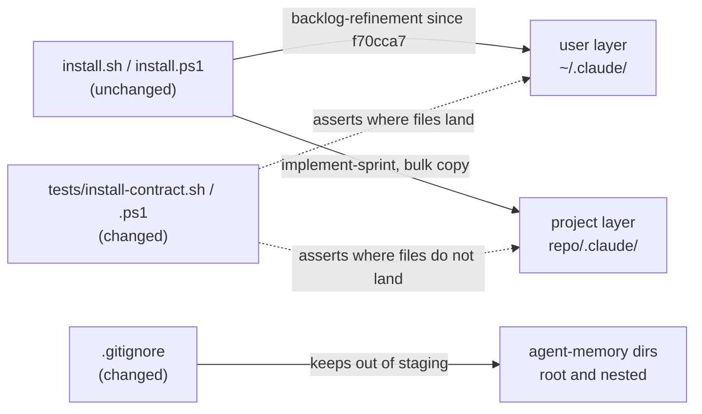
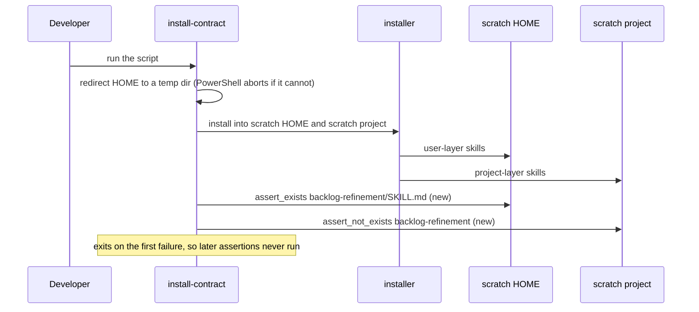

# Walkthrough: two stale items on main — the install contract and the agent-memory ignore

**Branch:** `fix/stale-install-contract-and-ignore` · **Diff base:** `91c468a`
(working tree uncommitted at review time — no PR opened yet, so anchors are
file and line against the working tree, not a commit)

Two unrelated defects were already on `main`. `tests/install-contract.{sh,ps1}`
still asserted that `backlog-refinement` installs at the project layer after
`f70cca7` deliberately moved it to the user layer, so the contract tests had
been red since 14 October. And `.gitignore`'s `.claude/agent-memory/` rule only
matched at the repository root, so a nested copy escaped it. Both were found
during the `2026-10-17-unity-blender-assets` run and deliberately left out of
it; this change fixes them and nothing else.

**Out of scope:** no installer change (`install.sh`, `install.ps1` are
untouched), no skill move, no restructuring of the test scripts, no other
`.gitignore` line.

## Architecture — where the two fixes sit

The two halves of the diagram are unrelated to each other; they share a PR
because they share a provenance, not a cause.

## Sequence — what the contract test does

## Change table

| File | Change | Notes |
| --- | --- | --- |
| `tests/install-contract.sh` | One stale assertion replaced by an exists/not-exists pair | Reached first |
| `tests/install-contract.ps1` | The same pair, PowerShell | Kept equivalent to the bash script |
| `.gitignore` | `/.claude/agent-memory/` becomes `**/.claude/agent-memory/` | Independent of the other two files |

Nine insertions across the three files; nothing is noise.

## The flow

| Entrypoint | Trigger | First changed file it reaches |
| --- | --- | --- |
| `tests/install-contract.sh` / `.ps1` | A developer runs the contract test | The assertion block at `install-contract.sh:140-143` / `install-contract.ps1:163-166` |
| `git status` / `git add` | Any staging step | `.gitignore:7` |

The test scripts do their setup first (`install-contract.sh:30-38`,
`install-contract.ps1:37-45`): redirect `HOME` to a temp directory, install into
a temp project, then assert. That setup is unchanged, but the new positive
assertion depends on it, which is why it matters below. The walkthrough follows
the test flow first, then the ignore rule.

## The decisions

### Which side of the red test was wrong (`install-contract.sh:140`, `install-contract.ps1:163`)

- **Decided:** the test was wrong, the installer was right. The assertion moved
  to the user layer; the installer was not touched.
- **Why:** `f70cca7`'s own message states the intent — `backlog-refinement`
  installs "at the user level alongside the loops that call it, not at the
  project level". The installer does what that says; the assertion was simply
  never carried along.
- **Alternatives considered:** changing the installer to put the skill back at
  the project layer so the old assertion passes — rejected, it reverts a
  deliberate decision to satisfy a stale check, the tail wagging the dog.
  Deleting the assertion — rejected, it drops coverage of a skill that is still
  installed, just elsewhere.
- **Forced by:** `f70cca7`'s stated intent.

### Two assertions, not one (`install-contract.sh:140-143`, `install-contract.ps1:163-166`)

- **Decided:** an `assert_exists` at the user layer **plus** an
  `assert_not_exists` at the project layer.
- **Why:** one positive check only restates where the skill happens to be
  today. The pair encodes both halves of what `f70cca7` decided, so it fails if
  the skill moves back as well as if it stops being installed. The file already
  does exactly this for `coding-standards` (`install-contract.sh:132-137`,
  `install-contract.ps1:155-160`), so this follows a precedent rather than
  inventing one.
- **Alternatives considered:** a single positive assertion — rejected as above.
  Pointing the project-layer check at a different skill — rejected,
  `implement-sprint` already covers the bulk project-layer copy on the line
  above, so it would duplicate.
- **Forced by:** the `coding-standards` precedent in the same file.

### The ignore pattern (`.gitignore:7`)

- **Decided:** `**/.claude/agent-memory/`.
- **Why the old rule missed:** a gitignore pattern containing a slash is
  anchored to the directory holding the `.gitignore`, so
  `/.claude/agent-memory/` matched only the root. A nested copy such as
  `docs/diagrams/.claude/agent-memory/` escaped it and really did leave
  untracked agent memory that a staging step could have swept into a commit.
  `**/` matches zero or more leading components, so one line covers the root
  copy as well as every nested one.
- **Alternatives considered:** keeping the root line and adding a second `**/`
  line — rejected as redundant, since `**/` already includes the zero-directory
  case. A bare `agent-memory/` — rejected as too broad: it would ignore any
  directory of that name anywhere, including one unrelated to agent memory.
- **Forced by:** nothing — a free choice among correct options, taking the
  narrowest.

## Where the review attacked

The one thing the reviewer was asked to break was the new positive assertion's
`$HOME`. An assertion that read the developer's real home would pass on any
machine that had ever run the installer — passing for the wrong reason, which
is worse than failing. The reviewer confirmed from the scripts' setup code, not
the header comment, that bash exports `HOME` to the temp directory
(`install-contract.sh:30-38`) and that PowerShell uses `$TmpHome` with a guard
that aborts if the redirect fails (`install-contract.ps1:41-45`). It also
confirmed the negative assertion fails when the skill appears at the project
layer even if it is also present at the user layer, so a partial move cannot
satisfy the pair.

For the ignore rule it checked over-matching, the direction that loses work
silently: `.claude/agent-memoryx/`, `.claude/skills/` and
`docs/.claude/settings.json` are still not ignored.

## Where to look to review this

1. `tests/install-contract.sh:140-143` and `tests/install-contract.ps1:163-166`
   — the pair. Check the two scripts say the same thing.
2. `tests/install-contract.ps1:41-45` — the `HOME` guard the positive
   assertion leans on.
3. `.gitignore:7` — one line.

## Tests

The change is the tests, so there is no separate regression test. What ran:
both scripts pass in full. The point worth knowing is that `main` had been red
since 14 October, and because both scripts exit on the first failure, the twelve
assertions after the stale one had not executed at all in that time. They all
pass now; nothing was hiding behind it. The ignore rule was checked with
`git check-ignore` for the root path, nested paths at two depths, and the three
neighbours above. Not covered: no automated test exists for `.gitignore`, and
none was added.

## Open questions

None.
