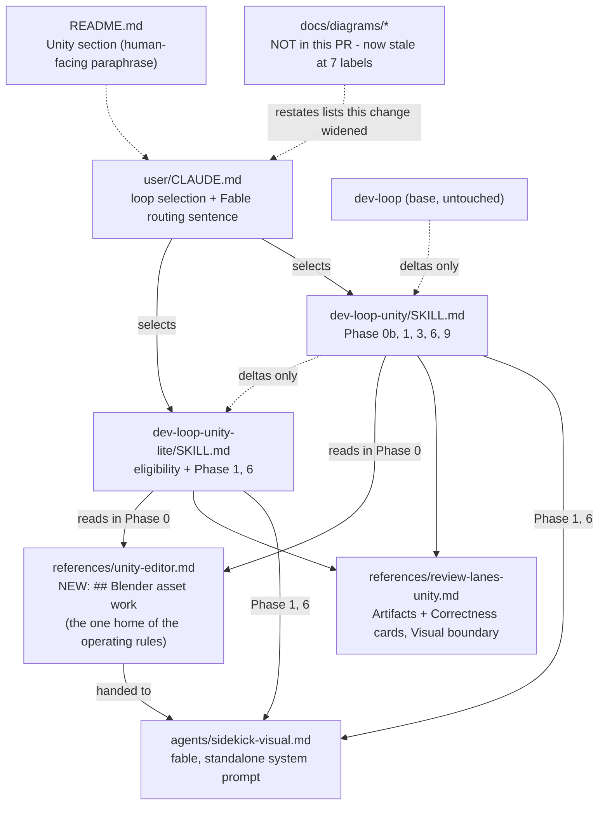
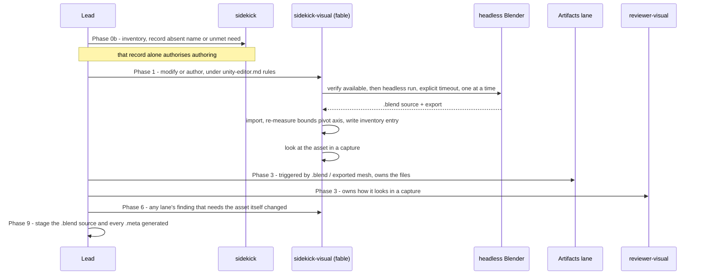

# Walkthrough: Blender asset work in the two single-player Unity loops

**Branch:** `feat/unity-blender-assets` · **Diff base:** `main` (merge base
`91c468a`; working tree uncommitted at review time and no PR opened yet, so
anchors below are file and line against the working tree, not a commit hash —
line numbers will drift once this is committed and edited)

`dev-loop-unity` and `dev-loop-unity-lite` may now modify an existing 3D asset
in headless Blender, and the full loop may author a new one that does not
exist. Both are routed to `sidekick-visual` and reviewed by the loops'
existing lanes rather than exempted from review. The repository is a library
of files that agents load and execute, so the markdown *is* the code here: a
rule that two files state differently behaves exactly like two code paths
disagreeing about a value, and all nine findings across the two review rounds
(all Minor) were that one defect class. Most of what follows is about where
each rule was allowed to live so that it could only be said once.

**Out of scope:** no new agent, lane or phase; no change to `reviewer-visual`,
the general ladder, the cost model or the cost tables (Blender work sits
inside the existing Fable `Impl` bucket); no Blender tooling or scripts in
this repository. **One deferral is carried knowingly, not classified as out of
scope:** three diagrams under `docs/diagrams/` now restate stale eligibility
lists — see "The deferral" below.

## Architecture — where the change sits

The layering is the constraint this change had to respect: `dev-loop` is the
base, `dev-loop-unity` restates only its deltas, and `dev-loop-unity-lite`
restates only its deltas from that. Rules true of both Unity loops live once
in a shared reference.

`sidekick-visual` and `reviewer-visual` remain the only two agents pinned to
Fable. The routing sentence in `user/CLAUDE.md` widens what `sidekick-visual`
is handed; it does not widen what may route to Fable.

## Sequence — how a Blender asset is made and reviewed (full loop)

In the lite loop the same path starts at Phase 1 with the asset already
existing: there is no Phase 0b, so there is no authoring branch.

## Change table

| File | Change | Notes |
| --- | --- | --- |
| `user/.claude/skills/dev-loop-unity/references/unity-editor.md` | New `## Blender asset work` section (31 lines) | The one home of the operating rules |
| `user/.claude/skills/dev-loop-unity/SKILL.md` | Phase 0b trigger, Phase 1 and 6 routing, Artifacts row, Phase 9 staging, eligibility restatements | Deltas only |
| `user/.claude/skills/dev-loop-unity-lite/SKILL.md` | Authoring joins "wrong loop" and escalation; modifying stays eligible; Phase 1 and 6 routing | No Phase 9 change, deliberately |
| `user/.claude/skills/dev-loop-unity/references/review-lanes-unity.md` | Artifacts and Correctness own the asset as a file; Visual's "does not own" names asset files | Ownership |
| `user/.claude/agents/sidekick-visual.md` | New role: Blender asset work, with its own copy of the safety rules | The one deliberate second statement |
| `user/CLAUDE.md` | Selection and escalation lines; one routing sentence in the Fable exception | Loaded every session |
| `README.md` | Unity section says Blender work is in scope, on Fable, reviewed not exempted | Human-facing paraphrase |

No row is noise; every one is a hand-edited instruction file.

## The flow

| Entrypoint | Trigger | First changed file it reaches |
| --- | --- | --- |
| Choosing a loop for a task that needs a 3D asset | The lead reads the ladder before starting | `user/CLAUDE.md:81-92` |

1. **`user/CLAUDE.md:81-92`** — selection. A task that needs a newly authored
   3D asset is not lite; one that modifies an asset is. The same criterion is
   restated in both loops' frontmatter and their eligibility and escalation
   bullets (`dev-loop-unity/SKILL.md:12,66`,
   `dev-loop-unity-lite/SKILL.md:6-12,49-57`). That list is restated in five
   places by design; a selector reading any one of them must reach the same
   answer.
2. **`dev-loop-unity/SKILL.md:95-104`, Phase 0b.** The inventory pass records
   a name that does not exist, or a need no shipped asset or variant meets,
   as *absent*. That one record is the authorisation.
3. **`dev-loop-unity/SKILL.md:119-123`, Phase 1.** Blender work is routed to
   `sidekick-visual` on the same turn limits and self-QA cap as scene work,
   and the agent re-measures after import and writes the inventory entry.
4. **`unity-editor.md:88-117`.** The operating rules: verify Blender runs,
   headless with an explicit timeout, copy vendor assets, keep the source
   beside the export, export on the project's scale and axis, re-measure,
   change no project-wide setting.
5. **`dev-loop-unity/SKILL.md:154`, Phase 3.** The Artifacts row triggers on
   `.blend` or exported-mesh changes; `review-lanes-unity.md:93-95` and
   `:135-137` say what the Artifacts and Correctness cards own.
6. **`dev-loop-unity/SKILL.md:177-178`, Phase 6.** A finding from *any* lane
   whose fix is changing the asset itself goes back to `sidekick-visual`;
   lite Phase 6 (`dev-loop-unity-lite/SKILL.md:128-131`) matches.
7. **`dev-loop-unity/SKILL.md:192-194`, Phase 9.** Staging accounts for the
   `.blend` source and every `.meta` the asset generates.

## Decisions

### The authoring trigger is defined once, at Phase 0b (`dev-loop-unity/SKILL.md:102-104`)

- **Decided:** Phase 0b's inventory records both "a name that does not exist"
  and "a need no shipped asset or variant meets" as absent, and that single
  record authorises authoring. Everywhere else — `unity-editor.md:90-95`, the
  agent file, the routing sentence in `user/CLAUDE.md` — points at it or says
  nothing about the trigger.
- **Why:** Round 1 (`cor-002`) found the trigger stated three ways, with
  `unity-editor.md` carrying a second route — a brief or bible requirement no
  shipped asset meets — that no phase owns. A lite-loop sidekick reads that
  file but runs no Phase 0b, so it could reach an authorising condition the
  lite loop's own rule says it must never act on.
- **The extra route came from the brief, not the implementer.** `brief.md`
  pinned the second route as a disjunct and the implementer followed it
  exactly. The wrong instruction was the lead's. A reviewer would otherwise
  read an unowned route as something the implementer invented.
- **Alternatives considered:** The finding's own suggested fix was to delete
  the unowned disjunct. Rejected: it loses a real case — the asset exists but
  no shipped variant meets the need — which is exactly when authoring is
  justified. The narrower remedy keeps both cases and gives the second one an
  owner. `user/CLAUDE.md` mirroring both cases was also rejected (round 2,
  `str-004`) because it would be a third copy of a definition that now has one
  home.
- **Forced by:** the vendor-shipped-first constraint and the lite loop's
  Phase 0b exclusion.

### Operating rules live once, in `unity-editor.md`, not in either `SKILL.md`

- **Decided:** one new section at `unity-editor.md:88-117`, after the
  scene-building lessons. The `SKILL.md` files name it and nothing more
  (`dev-loop-unity/SKILL.md:31`, `dev-loop-unity-lite/SKILL.md:88-90`).
- **Why:** it is the one file both loops already read in Phase 0 and hand to
  every sidekick and to the Visual lane, so a reviewer judging an authored
  asset sees the same rules the author worked to. One home is one place to
  change.
- **Alternatives considered:** the rules in `sidekick-visual.md` alone —
  rejected, the loops distribute the reference, not the agent prompt.
  Duplicating into both `SKILL.md` files — barred by the layering. A bullet in
  the existing scene-building list — rejected, it would bury seven rules among
  unrelated lessons.
- **Forced by:** the brief's "rules live once" and "preserve the layering"
  constraints.

### Authoring is not lite-eligible; modifying is (`dev-loop-unity-lite/SKILL.md:49-57`)

- **Decided:** a newly authored 3D asset joins the lite loop's wrong-loop
  list and both escalation triggers. Modifying an existing asset is stated
  outright as staying contained, and `unity-editor.md:94-95` says authoring is
  full-loop only.
- **Why:** authoring is authorised by a Phase 0b inventory record, and the
  lite loop runs no Phase 0b — it can never produce the record that makes
  authoring legitimate. Modifying an existing asset needs no such record and is
  as contained as retiming a lighting rig, which the lite loop already owns.
- **Alternatives considered:** allowing both in lite — rejected, it lets a loop
  author an asset with no measured inventory behind it. Excluding both —
  rejected, it would force the full loop onto a one-asset tweak.
- **Forced by:** the lite loop's own Phase 0b exclusion.

### Authoring sits below the vendor-shipped check (`unity-editor.md:90-95`)

- **Decided:** the section opens by calling authoring "the rung below" the
  existing check-vendor-variants-first bullet.
- **Why:** the cheapest asset is the one already in the package; without the
  gate, "I cannot find an asset" turns into a modelling task.
- **Alternatives considered:** authoring as a free choice for the agent —
  rejected, it inverts the existing rung order.
- **Forced by:** the brief's vendor-shipped-first constraint.

### Review ownership: Artifacts and Correctness own the file, Visual owns the pixels (`review-lanes-unity.md:28-31,93-95,135-137`)

- **Decided:** the Artifacts card (full loop) and the Correctness card (lite,
  which folds Artifacts in) own a Blender-authored or -modified asset *as a
  file*: the `.blend` source beside its export, no vendor asset edited in
  place. Visual's "does not own" names asset files; its "owns" is untouched.
  The Artifacts applicability row gains `.blend` and exported mesh
  (`dev-loop-unity/SKILL.md:154`).
- **Why:** a new reviewable kind of file with no named owner falls between
  Visual, which sees only pixels, and Technical, which reads C# — a review
  gap, not a saving. Each reviewer reads only its own card, so ownership has
  to be on that card.
- **Alternatives considered:** a new lane — out of scope and unjustified for
  one file kind. Letting the lite Correctness card inherit the clause through
  its existing "as the full-loop cards define them" — rejected, a reviewer
  does not follow the cross-reference, so the inheritance is invisible to it.
- **Forced by:** the brief's "assigned, not left implicit" constraint.

### The eligibility list was updated everywhere it is restated

- **Decided:** the implementer widened the edit beyond the brief's literal pin
  (the lite file) to both loops' frontmatter, the full loop's selection and
  escalation bullets, and `user/CLAUDE.md`. Accepted on review.
- **Why:** updating only the lite body would have left `user/CLAUDE.md` — the
  file a lead actually reads when choosing a loop — saying authoring is
  lite-eligible, a contradiction between two files loaded at the same moment.
- **Alternatives considered:** keeping to the brief's literal scope — rejected
  for that contradiction.
- **Forced by:** nothing; the brief was under-specified and this is the
  interpretation taken on the user's behalf.

### Two suggested remedies rejected, one narrowed, on accepted findings

- **Rejected: deleting the unowned authoring route** (`cor-002`, under the
  trigger decision above). It loses a real case, so the route was given an
  owner instead.
- **Rejected: dictating where the `.blend` lives (`cor-004`, Phase 9 staging,
  `dev-loop-unity/SKILL.md:192-194`).** The clause named "the `.blend` source
  and the export's `.meta`", which reads as exhaustive and is narrower than
  the general every-new-asset `.meta` rule beside it. The suggested second
  remedy was to state where the `.blend` lives relative to `Assets/`.
  Per-project layout is not this library's decision, and the rules as written
  work with the source inside or outside `Assets/`. The clause now covers
  every `.meta` the asset generates, whatever the layout.
- **Narrowed, not rejected: `cor-001`, `unity-editor.md:106-108`.** "Commit
  the `.blend` source" was an instruction to an agent whose own prompt says
  "do not commit". The remedy addresses the artifact, not the actor: the
  source is *kept* beside its export so the lead stages both.

### Round 2 deleted the lite staging clause instead of syncing it (`dev-loop-unity-lite/SKILL.md`, Phase 9)

- **Decided:** the lite loop's Phase 9 staging clause, added by this change,
  was reverted to its `main` wording. The lite loop carries no Blender staging
  rule and relies on the phase's existing "As `dev-loop-unity`" opener.
- **Why:** the clause read "`.meta` staged for every new asset and any
  `.blend` source", which, read literally, stages the `.blend`'s `.meta`
  rather than the source — the opposite of the full loop's reworded clause
  (`cor-005`; Structure's `str-003` found the same site independently and was
  counted as a duplicate). Both lanes offered "mirror the wording" or "drop the
  copy". Mirroring leaves two copies of a rule to keep in step, which had
  already failed twice in this run. Deleting removes the defect class, not
  just the instance, and makes the diff smaller.
- **Alternatives considered:** mirroring — rejected as above. Deleting the
  full loop's clause and letting both inherit from `dev-loop` — rejected,
  `dev-loop` has no Unity asset concept, so the rule would have no home.
- **Not a termination trigger, and worth saying so.** The lite loop stops on
  "the same concern raised and fixed twice". This was the other case: the fix
  was correct and stayed correct, and a sibling restatement was missed. The
  triage records that distinction explicitly because it decided whether the
  run could ship.

### `sidekick-visual.md` is the one place a second statement was right (`sidekick-visual.md:61-68`)

- **Decided:** the agent file restates the vendor-copy rule, the blocker rule
  and the inventory exception ("report it instead where the project keeps no
  inventory") rather than pointing at `unity-editor.md`.
- **Why:** it is the agent's own system prompt, read standalone on every run.
  A pointer to another file's bullet is weaker there than a dozen words that
  stand alone. This is the deliberate exception to "say it once", and it is
  the reviewer's most likely objection to this diff — which is why it has its
  own entry.
- **Alternatives considered:** a pointer to the re-measure bullet — rejected
  as above. Dropping the exception from the agent file — rejected, the lite
  loop may have no inventory file, and the agent would be told to write into
  one that may not exist.
- **Inventory entry owner (`cor-003`, `str-002`):** the entry was stated four
  ways across three files. The one owner chosen is `sidekick-visual`, writing
  from its own post-import measurement, matching Phase 0b's pattern of the
  measuring agent writing what it measured.
- **Forced by:** the agent file being a standalone prompt.

### `user/CLAUDE.md` states routing, not the trigger (`user/CLAUDE.md:155-157`)

- **Decided:** the Fable-exception sentence says "modifying a 3D asset, or
  authoring a new one" with no trigger qualifier. `README.md:356-363` keeps a
  paraphrase but names both of Phase 0b's cases.
- **Why:** that sentence answers *what may go to Fable*, so a trigger
  qualifier there is surplus; and `user/CLAUDE.md` is loaded every session, so
  a half-stated trigger reads as licence. The README documents for humans, where
  a paraphrase is right as long as it is not half the rule.
- **Alternatives considered:** mirroring both cases in `user/CLAUDE.md` —
  rejected, a third copy of a one-home definition.
- **Forced by:** nothing; free choice. The reviewer raised it at low
  confidence, and the reasoning was accepted over the confidence.

### Why `reviewer-verify` ran when no rule required it

- **Decided:** a verification pass after round 2, although no trigger fired —
  no Critical, no Major with `would_have_been_bug`, no artifact change.
- **Why:** twice in this run a wording fix resolved a divergence in one file
  and left a sibling restatement behind, and round 2's fixes were the last
  changes no lane would see. It cost one pass and guarded the only defect
  class this change produced. It passed the change: all six rules say one
  thing at every site, and round 2 introduced no new sibling divergence.
- **Alternatives considered:** stopping at round 2 as the rules allow.
- **Forced by:** nothing; it was a deliberate deviation, stated rather than
  taken silently.

## The deferral: three diagrams are now stale

`docs/diagrams/*` restates the eligibility and escalation lists this change
widened. `loop-selection`, `dev-loop-unity` and `dev-loop-unity-lite` are now
incomplete at seven labels, including the full loop's wave-2 Artifacts trigger
boxes, which no longer mention `.blend` or exported mesh. `README.md` embeds
two of the rendered PNGs just above its own new prose saying authoring needs
the full loop.

The part to read carefully: the brief declared diagram regeneration a
non-goal, which made it *feel* like `stale` — pre-existing debt the diff
merely sits beside. It is not. The diagrams were complete before this change
and are incomplete because of it, so the cause is `worsened`, and this repo's
own gate says `worsened` is fixed, not recorded. `reviewer-verify` found this
(`ver-001`, Minor) and the lead had filed it as scope until then.

It is being deferred anyway, visibly:

- every file an agent loads states the criterion correctly, so the failure
  mode is a human misreading a picture, and a lite run that turns out to need
  authoring escalates by its own rule;
- the fix is re-exporting three `.drawio` files and their PNGs — a different
  kind of work from the seven markdown files reviewed here, and it would land
  unreviewed by any lane in this run.

That is a deferral of something the gate says to fix, not a classification
that it need not be fixed. It is named in the PR body and is the first thing to
pick up after this merges.

## Where to look to review this

1. `sidekick-visual.md:61-68` against `unity-editor.md:88-117` — the one
   deliberate duplication. Check the agent's copy matches the reference's
   meaning, including the no-inventory exception; this is where the run's
   defect class is most likely to recur.
2. `dev-loop-unity/SKILL.md:102-104` and `unity-editor.md:90-95` — the single
   trigger and its "full-loop only" statement. Confirm nothing else in the
   seven files defines when authoring is permitted.
3. `dev-loop-unity-lite/SKILL.md:49-57,85-90,128-131` — authoring excluded,
   modifying allowed, and the absence of a lite Phase 9 clause (an absence, so
   easy to read past).
4. `review-lanes-unity.md:93-95,135-137` with `:28-31` — the file/pixels
   boundary between Artifacts, Correctness and Visual.
5. `README.md:360` says the `.blend` source "is committed beside its
   export", while `unity-editor.md:106-108` says it is *kept* beside it and
   the lead commits. This is a known wording difference, not an open
   contradiction: README instructs no agent, and the verification pass judged
   it an acceptable human-facing paraphrase of the net effect. It is still the
   word `cor-001` objected to in the agent-facing file, so change README to
   match if you want the two literally identical.
6. `user/CLAUDE.md:81-92,155-157` — selection and the confined Fable
   exception.

## Tests

No tests were written and none could fail: the change is instruction prose in
seven markdown files, nothing was added, removed or moved on disk, and the
repository's only test asserts the installer's filesystem contract. The Tests
lane ran mutation testing in a scratch worktree and reported the honest
result — emptying the seven files still passes — and raised nothing, which is
correct. A test asserting that particular sentences appear in a skill file
would assert the diff against itself and break on any correct reword.

**Pre-existing failure, not fixed:** `bash tests/install-contract.sh` fails at
`bulk project-layer copy still lands backlog-refinement`, identically on a
stashed tree at `main`. Commit `f70cca7` moved `backlog-refinement` to the user
layer and the test still expects it in the project layer. With that one
assertion neutralised, the Tests lane confirmed all remaining bash and PowerShell
assertions pass. It is `cause: stale`; fixing it would make this diff two
changes. The brief's definition-of-done item 9 assumed a green baseline that
did not exist.

Review: round 1 raised 5 Minor (Correctness 4, Structure 1, Tests 0, Security
0); round 2 raised 4 Minor clustering to 3 concerns. All accepted, none
rejected as findings, no Critical or Major in either round. Security ran on a
markdown-only diff deliberately, because the change grants an agent permission
to invoke an external binary; it confirmed no tool or frontmatter was added and
the new rules narrow rather than widen what the agent may do.

## Open questions

- Whether headless Blender should be told explicitly not to auto-execute
  embedded Python when it opens a vendor-shipped `.blend`. The Security lane
  flagged that it could not verify Blender's behaviour from inside this
  repository, and raised no finding. Modern Blender disables script
  auto-execution by default and a vendor package is a trusted dependency, so
  this run adds no line about it rather than adding unrequested hardening prose
  on an unverified premise. It is one bullet in `unity-editor.md` if the owner
  wants the belt and braces.
- Whether a `.blend` source belongs inside `Assets/` beside its export or
  outside it in a sources folder. Deliberately left to the project; the rules
  as written work either way.
- The three diagrams above, and whether they should have been regenerated in
  this PR rather than after it. Stated as a deferral, not a classification.
